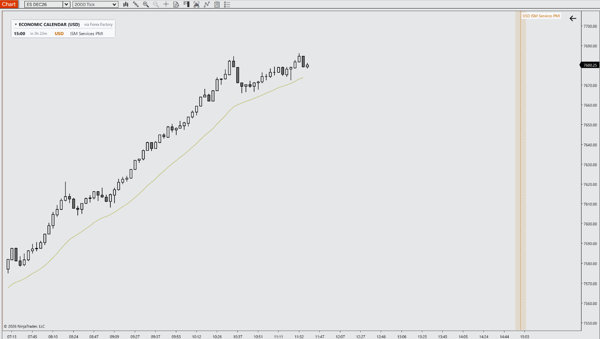

# icPA - News for NinjaTrader 8

A specialized Indicator engineered for Price Action day trading. It brings this week's Forex Factory economic calendar onto your chart as a compact panel with live countdowns, vertical event markers and shaded news windows, so you always know when the next release can hit your market.

---

## 📺 Video Walkthrough & Setup

Watch the complete breakdown of parameters, price action context, and chart examples on YouTube:

> **[▶ Click here to watch the full YouTube walkthrough](https://youtube.com/@icPriceAction)**

---

## ⚡ Key Features

- **On-Chart Economic Calendar:** A dockable panel lists upcoming and recent events with local time, a live countdown ("in 1h 25m", "NOW", "12m ago"), currency and title, grouped by day. Click the panel to collapse it to a single header line showing the next event's time and countdown.
- **News Markers, Zones & Alerts:** Vertical lines mark each event, colored by impact, and optional shaded zones cover a configurable window before and after it. Upcoming events that are still off-screen are pinned to the chart's right edge with their time and countdown, including on tick charts. Optional NinjaTrader alerts fire a set number of minutes before high (and optionally medium) impact events.
- **Smart Currency Detection & Strategy Flag:** The relevant currencies are detected from the instrument (ES/NQ → USD, 6E → EUR/USD, FDAX → EUR, forex pairs, and more), or you can set your own list. Strategies can read `IsInNewsWindow`, `MinutesToNextEvent` and `NextEventDescription` to stand aside around news in real time.
- **PATS & Context Aligned:** Designed for Price Action principles (Mack / Thomas Wade) and disciplined futures execution.
- **Zero Chart Lag:** Native C# execution optimized to prevent UI freezes on high-frequency 2000-tick ES/MES charts.
- **Clean Visuals:** Complementary default palette that preserves candlestick clarity without chart clutter.
- **Fully Customizable:** Configure colors, thresholds, offsets, and alerts via the native NT8 settings panel.

---

## ⚠️ Prerequisites & Data Requirements

- **Works on any chart.** No Tick Replay and no special Calculate mode needed.
- **Internet connection required.** Data comes from the Forex Factory weekly calendar feed, which covers the **current week only** (no history). The calendar is downloaded at most once an hour and shared by all charts, with a disk cache in your NinjaTrader user folder (`icPANews_FF_Cache.json`).
- Past events are placed on the bar where they occurred. Upcoming events and zones are placed where the chart's time axis shows their time. On **non-time-based charts** (Tick, Range, Renko, Volume, ...) NinjaTrader's future time axis is itself an estimate of when bars will form, so an upcoming line shifts as the market speeds up or slows down. **Daily and higher** charts show the panel only.
- **Upcoming events beyond the right edge** of the chart (within HUD Lookforward Minutes) are pinned to the right edge with a `▸ 15:00 USD ... (in 3h 50m)` label, so you see them before they happen on any chart type.
- Times are shown in the time zone set in NinjaTrader (`Tools` ➔ `Options` ➔ `General`).
- Events the feed publishes at midnight New York time are shown as **All day** (tentative or holiday items) and have no line, zone or countdown.
- **Strategy use:** `IsInNewsWindow` and the other strategy properties only answer in real time. In backtests and optimizations they always return false / empty, because the feed has no history. Test any strategy that uses them in **Sim101** or **Playback** first.

---

## 📥 Installation Guide

1. Head to the **[Releases](https://github.com/icPriceAction/news/releases)** tab of this repository.
2. Download the latest release `.zip` file (`icPriceAction_icPANews_v1.5.4.zip`).
   - *Note: Do NOT extract or unzip the file.*
3. Open **NinjaTrader 8**.
4. In the Control Center, navigate to:
   `Tools` ➔ `Import` ➔ `NinjaScript Add-On...`
5. Select the downloaded `.zip` file and click **Open**.
6. A success dialog will appear confirming the tool has been imported.
7. Open any chart, press `Ctrl + I`, find **icPA - News** in the **icPA** folder, and add it.

---

## ⚙️ Parameters & Configuration

| Parameter | Group | Type | Default | Description |
| :--- | :--- | :--- | :--- | :--- |
| High Impact | 1. Filters | Bool | True | Show high impact events |
| Medium Impact | 1. Filters | Bool | False | Show medium impact events |
| Low Impact | 1. Filters | Bool | False | Show low impact events |
| Bank Holidays | 1. Filters | Bool | False | Show bank holidays (thin liquidity days) |
| Currencies | 1. Filters | Text | Auto | Auto = detect from the instrument. All = every currency. Or a comma-separated list, e.g. `USD,EUR,CNY` |
| HUD Lookback Minutes | 1. Filters | Int (0–1440) | 120 | Past events older than this are removed from the HUD |
| HUD Lookforward Minutes | 1. Filters | Int (1–1440) | 240 | Events further ahead than this are not listed in the HUD or pinned to the chart's right edge |
| Theme | 2. Appearance | Auto / Dark / Light / Custom | Auto | Auto follows the chart background. Custom lets you pick every color |
| Background Opacity | 2. Appearance | Double (0–1) | 0.90 | HUD and label background opacity |
| Background Color | 2. Appearance | Color | #14181E | HUD panel background (shown only with the Custom theme) |
| Border Color | 2. Appearance | Color | #464B55 | HUD panel border (Custom theme) |
| Text Color | 2. Appearance | Color | #F2F2F2 | Main HUD text (Custom theme) |
| Dimmed Text Color | 2. Appearance | Color | #A6ADB8 | Countdowns, low impact, holidays and past events (Custom theme) |
| High Impact Color | 2. Appearance | Color | #E62828 | High impact events (Custom theme) |
| Medium Impact Color | 2. Appearance | Color | #F09614 | Medium impact events (Custom theme) |
| Show HUD Panel | 3. HUD Dashboard | Bool | True | Display the calendar panel on the chart |
| HUD Corner | 3. HUD Dashboard | TopLeft / TopRight / BottomLeft / BottomRight | TopLeft | Corner of the chart to dock the panel |
| Font Size | 3. HUD Dashboard | Int (10–24) | 16 | HUD text font size (the panel scales with it) |
| Max HUD Rows | 3. HUD Dashboard | Int (1–50) | 8 | Maximum number of rows listed in the HUD |
| HUD Offset X | 3. HUD Dashboard | Int (0–2000) | 22 | Horizontal distance in pixels from the docked corner |
| HUD Offset Y | 3. HUD Dashboard | Int (0–2000) | 22 | Vertical distance in pixels from the docked corner |
| Show Indicator Label | 3. HUD Dashboard | Bool | False | Show the indicator name in the chart's top-left label line |
| Time Format | 3. HUD Dashboard | 24-hour / 12-hour | 24-hour | `13:30` or `1:30 PM` |
| Dim Past Events | 3. HUD Dashboard | Bool | True | Draw events that have already happened in the dimmed color |
| Show Vertical Lines | 4. Timeline Markers | Bool | True | Draw vertical event markers (hidden on Daily and higher charts) |
| Lines Show | 4. Timeline Markers | Entire Week / Same Window As HUD | Entire Week | Lines and zones for every matching event this week, or only events listed in the HUD |
| Line Thickness | 4. Timeline Markers | Float (1–10) | 1.5 | Thickness of the vertical markers |
| Line Dash Style | 4. Timeline Markers | Dash style | Dash | Dash pattern of the vertical markers |
| Shade News Zones | 5. News Window | Bool | True | Shade the chart from Minutes Before to Minutes After each event |
| Minutes Before | 5. News Window | Int (0–240) | 5 | News window start. Used by the zones and by `IsInNewsWindow` |
| Minutes After | 5. News Window | Int (0–240) | 5 | News window end. Used by the zones and by `IsInNewsWindow` |
| Zone Opacity | 5. News Window | Double (0–1) | 0.12 | Opacity of the shaded news zones |
| Enable Alerts | 6. Alerts | Bool | False | Raise a NinjaTrader alert before high impact events (real time only) |
| Alert Minutes Before | 6. Alerts | Int (1–120) | 5 | How many minutes before the event to alert |
| Alert On Medium Impact | 6. Alerts | Bool | False | Also alert before medium impact events |
| Alert Sound | 6. Alerts | Text | Alert2.wav | Sound file from the NinjaTrader `sounds` folder, a full path, or empty for no sound |

---

## 📝 Changelog

- **v1.5.4** (2026-11-04) - Initial public release. Cleaned and optimized by icPriceAction. Renamed to icPA - News; upcoming events placed on the chart's own time axis on every chart type, and pinned to the right edge with a countdown when off-screen; collapsing the panel leaves a single header line with the next event; click-to-collapse fix; faster, allocation-free rendering.
- **v1.4.2** (2026-11-03) - Strategy API answers in real time only; no countdown for all-day events; atomic disk cache write; collapsed empty panel divider fix.
- **v1.4.1** - Reliable click-to-collapse; empty collapsed panel shrinks to its header.
- **v1.4.0** - Time format (24h / 12h), day labels, dimmed past events, click-to-collapse.
- **v1.3.0** - Impact toggles, bank holidays, shaded news zones, alerts and the strategy API.
- **v1.2.1** - Panel drawn above drawing objects; indicator label hidden by default; HUD offsets.
- **v1.2.0** - Themes (Auto, Dark, Light, Custom); markers can cover the entire week.
- **v1.1.0** - Built-in JSON parser, chart-type aware markers, Currencies setting, all-day events.
- **v1.0.0** - Initial versions.

---

## ☕ Support the Project

All tools provided by **icPriceAction** are 100% free and open-source for personal trading use. These tools, even thou supported by AI have taken considerable time to design, build, test and package. If these tools bring you value, consider supporting continued development:

- **Prop Firm Traders:** Use discount code **`ICPAT`** at checkout across top futures prop evaluation firms ([View Active Discounts](https://icpriceaction.com/prop-firms.html)).
- **Profitable Traders:** Send a one-time tip to support my continued support and time, server hosting and open-source updates via [Buy Me a Coffee](https://buymeacoffee.com/icpriceaction).

---

## 🐛 Bug Reports & Feature Requests

Found an issue or have an enhancement idea?
Please submit an issue on the [Issues tab](https://github.com/icPriceAction/news/issues).

---

## License

Free for personal trading use. Commercial resale, redistribution, or repackaging is strictly prohibited. See [LICENSE](LICENSE).

---

## ⚖️ Disclaimer

Futures trading involves substantial risk of loss and is not suitable for every investor. All indicators, drawing tools, strategies, and documentation provided by **icPriceAction** are for educational and analytical purposes only. Nothing herein constitutes financial or investment advice. Automated strategies can lose money and may behave differently in live markets than in simulation or backtests.

NinjaTrader® is a registered trademark of NinjaTrader, LLC. icPriceAction is an independent developer with no official affiliation to NinjaTrader, LLC.